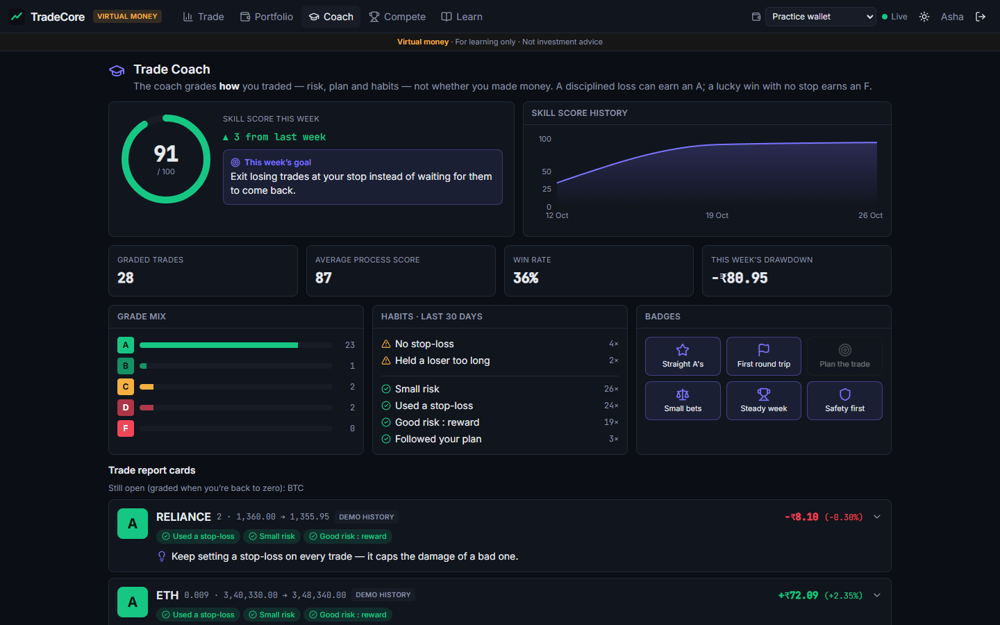
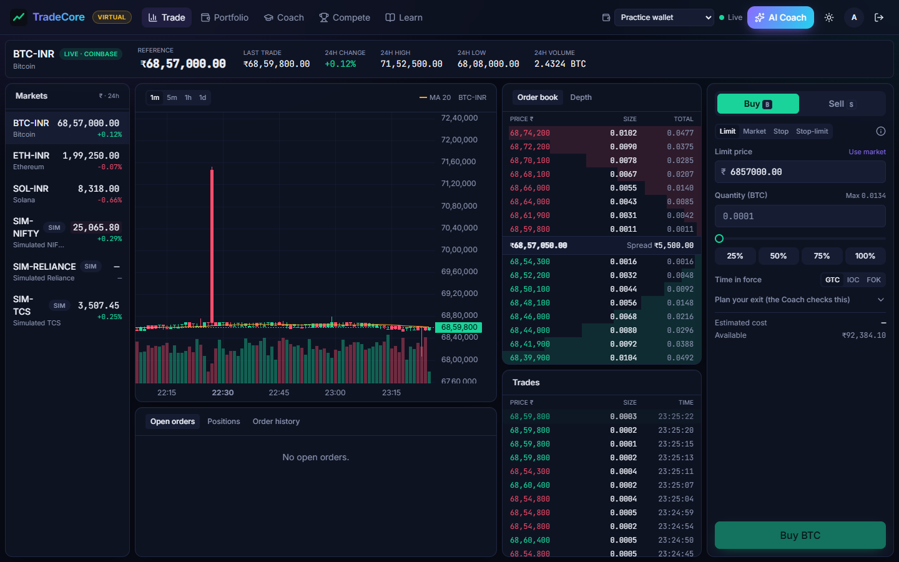
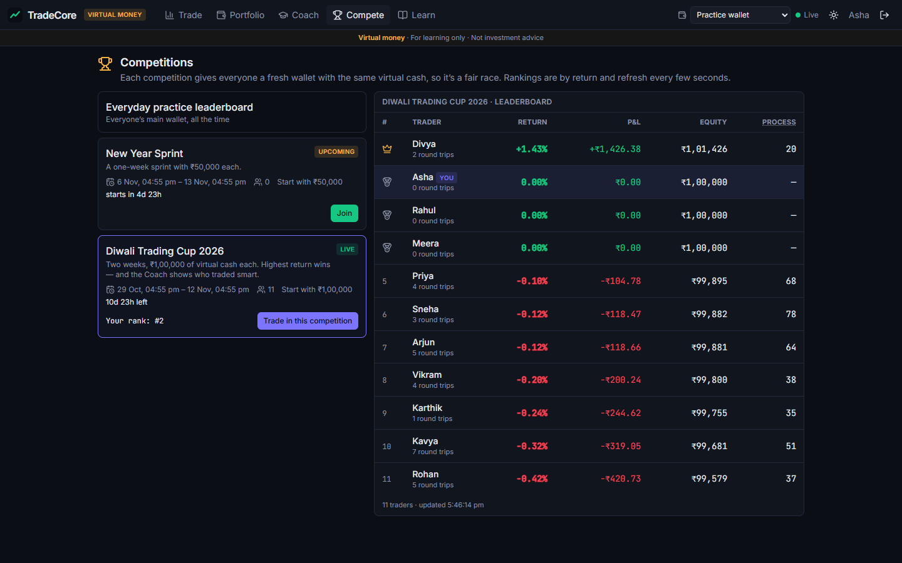
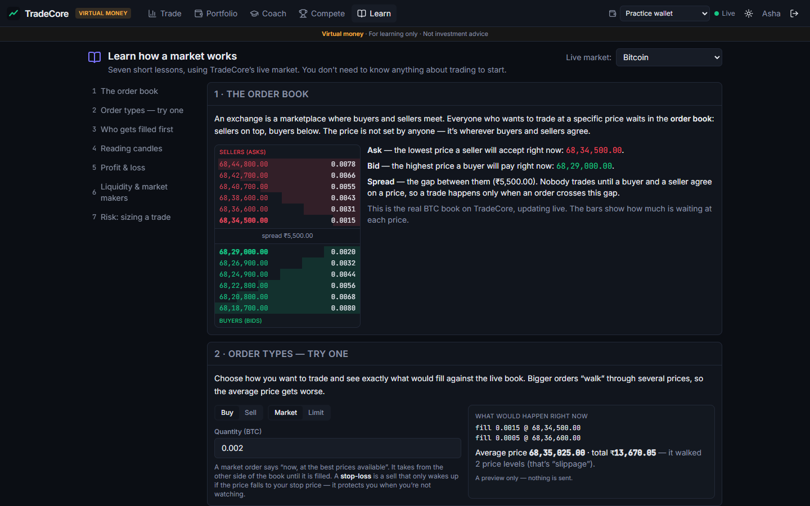
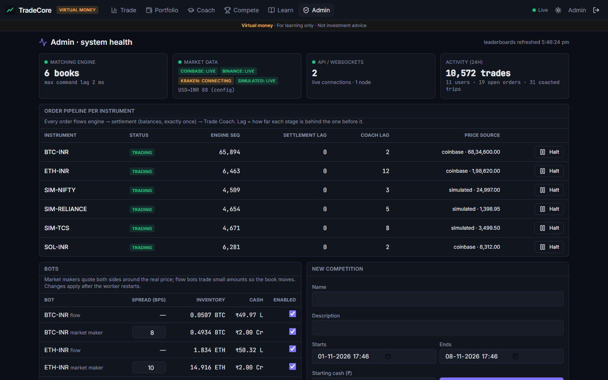
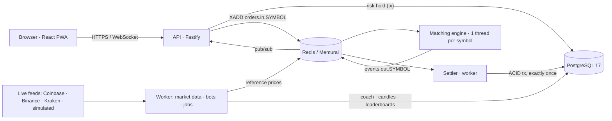
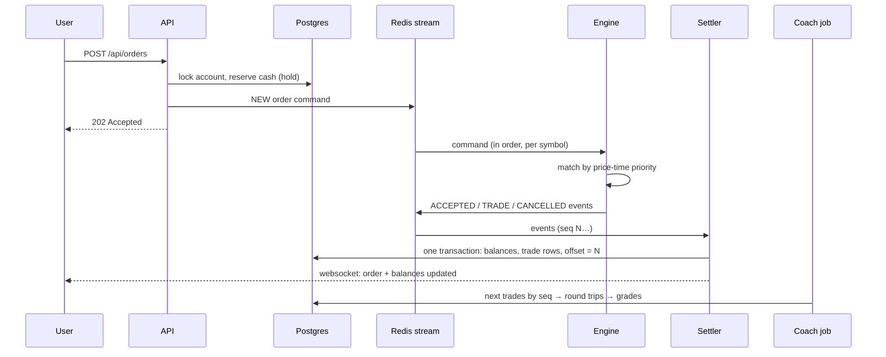

# TradeCore — learn to trade safely

**Practise trading with virtual money on real live prices — and get a coach that grades every trade on _how_ you traded,
not whether you got lucky.**

> Virtual money · For learning only · Not investment advice



## The problem

Millions of young Indians now trade through apps, and most learn by losing real money — SEBI found that about 9 in 10
individual futures & options traders lost money. Beginners rarely lose because they pick bad trades; they lose because
of habits: no stop-loss, betting too much, revenge trading after a loss, chasing spikes.

## What TradeCore does

- **A real exchange, with virtual money.** Every user gets ₹1,00,000. Prices track the real market (live Coinbase /
  Binance feeds with failover), but every trade is matched by TradeCore's **own order book and matching engine** and
  settled into PostgreSQL — so you feel real mechanics: spreads, partial fills, slippage.
- **Trade Coach.** Each finished trade gets an A–F grade for _process_ — stop-loss, risk to the stop, planned
  risk : reward, following the plan — and flags habits: FOMO, revenge trades, overtrading, holding losers. A weekly
  Skill Score, a goal for next week, and badges. A disciplined loss can earn an A; a lucky all-in win earns an F.
- **AI coach chat (Google Gemini).** Ask "where am I losing money?" or "what should I improve?" and get an answer
  built from your own grades, habits and trades — never buy/sell tips. Optional: set `GEMINI_API_KEY` in `.env`.
- **Competitions** with fresh, equal wallets and live leaderboards — where the Coach shows who traded _smart_.
- **Learn** — seven short lessons on the live market: the order book, an order preview that walks the real book, price-time
  priority, candles, P&L, liquidity, and a risk-based position-size calculator.
- **Admin** — health of every service, the engine → settlement → coach pipeline per symbol, halt/resume trading, bots,
  and an on-demand ledger audit.

| Trade                                | Compete                                  | Learn                                | Admin                                |
| ------------------------------------ | ---------------------------------------- | ------------------------------------ | ------------------------------------ |
|  |  |  |  |

## Architecture



### Life of an order



## Engineering highlights

- **Matching engine**: sorted price levels + hash map + FIFO queues; deterministic; event-sourced (replay rebuilds the
  book); property-based tests with fast-check. **~423,000 commands/sec**, p99 **6.8 µs** (engine only).
- **Money correctness**: integer paise, pre-trade holds under row locks, CHECK constraints, exactly-once settlement via
  an offset in the same transaction, a fixed lock order (no deadlocks), an append-only audit log, and an invariant checker
  that re-derives every balance.
- **Database**: daily partitions, partial / composite B-tree / BRIN indexes measured with `EXPLAIN ANALYZE`,
  materialized views refreshed concurrently, window functions for candles, rankings and drawdown —
  see [docs/DATABASE.md](docs/DATABASE.md).
- **Trade Coach**: a separate exactly-once consumer of settled trades; grading is a pure, unit-tested function.

## Measured results

| What                                  | Result                                                                                                         |
| ------------------------------------- | -------------------------------------------------------------------------------------------------------------- |
| Automated tests                       | **82** unit + integration (Vitest, real Postgres) and **5** Playwright e2e                                     |
| Engine benchmark                      | ~423k commands/s, p50 1.5 µs / p99 6.8 µs                                                                      |
| End-to-end load test (HTTP → settled) | **~285 orders/s** ceiling (1 API process, 4-core laptop running everything); insert → settled p50 **19–28 ms** |
| Correctness under load                | 27,806 orders: 0 lost, 0 stuck, all 8 ledger invariants hold                                                   |

Details and conditions: [docs/PERFORMANCE.md](docs/PERFORMANCE.md).

## Tech stack

React 19 · TypeScript · Vite · Tailwind · shadcn/ui · TanStack Query · Zustand · Framer Motion · TradingView
lightweight-charts · Recharts — Node.js 22 · Fastify · Socket.IO · Zod · pino · BullMQ — PostgreSQL 17 · Prisma (CRUD) +
raw SQL — Redis (Memurai / Valkey) — Vitest · fast-check · Supertest · Testing Library · Playwright — GitHub Actions ·
Docker Compose.

## Run it locally (Windows, no Docker)

Prerequisites: Node 22+, PostgreSQL 17, Memurai (or any Redis 6.2+).

```bash
cp .env.example .env        # then fill in PG_USER / PG_PASSWORD (Memurai: REDIS_URL=redis://127.0.0.1:6379)
npm install
npm run db:setup            # creates tradecore + tradecore_test, applies migrations
npm run db:seed             # instruments, bots, demo users, 14 days of history, a live competition
npm run dev                 # engine + API (:4300) + worker + web (:5200)
```

Open <http://localhost:5200>. Demo accounts (password `Demo@1234`): `asha@tradecore.dev`, `rahul@tradecore.dev`,
`meera@tradecore.dev`, `admin@tradecore.dev`. API docs: <http://localhost:4300/docs>.

With Docker: `docker compose up -d` (Postgres + Valkey), then the same npm steps — see `docker-compose.yml`.

### Useful commands

| Command                    | What it does                                                  |
| -------------------------- | ------------------------------------------------------------- |
| `npm test`                 | unit + integration tests (uses the `tradecore_test` database) |
| `npm run e2e`              | Playwright end-to-end tests (starts or reuses `npm run dev`)  |
| `npm run demo:traders`     | demo competitors place real orders for 10 minutes             |
| `npm run load:test`        | end-to-end load test against the running app                  |
| `npm run bench:engine`     | matching-engine-only benchmark                                |
| `npm run check:invariants` | audits the ledger in SQL                                      |
| `npm run screenshots`      | refreshes `docs/screenshots/`                                 |

## Demo script (5 minutes)

1. **Learn** → the live order book and spread; preview a market buy walking the book.
2. **Trade** as Asha → buy a little BTC with a planned stop and target; watch the order book and tape update live.
3. **Coach** → Asha's Skill Score, goal, report cards. Log in as **Rahul** to compare an impulsive trader (and see him
   improve in week two).
4. **Compete** → the live Diwali Trading Cup: the leader by return vs the leader by process score.
5. **Admin** → the pipeline per symbol; halt BTC (orders are refused), resume it; run the ledger check.

## Docs

- [Trading basics](docs/TRADING_BASICS.md) — every trading concept used, for beginners
- [Database design](docs/DATABASE.md) — schema, ER diagram, transactions, indexes with measurements
- [Performance](docs/PERFORMANCE.md) — benchmarks and load tests with their conditions
- [Decisions](docs/DECISIONS.md) — why things are the way they are
- [Interview notes](docs/INTERVIEW_NOTES.md) — 20 likely questions, answered simply
- [Deploy](docs/DEPLOY.md) — free-tier hosting plan (not yet tested)
- [Progress & mentor notes](docs/PROGRESS.md)

## Known limits / future work

- Not yet deployed; CI has not run on GitHub yet (no remote); Docker Compose untested on this machine.
- The server runs TypeScript via `tsx`; a bundled production build is future work.
- One API process saturates around 285 orders/s on the dev laptop — next step is several API processes behind a load
  balancer (rate limits, websockets and leaderboards are already shared through Redis/Postgres).
- Live crypto prices use a configured USD→INR rate, not a live FX feed. Indian stocks are simulated.
- The optional AI weekly summary is a feature flag only; it isn't implemented.
