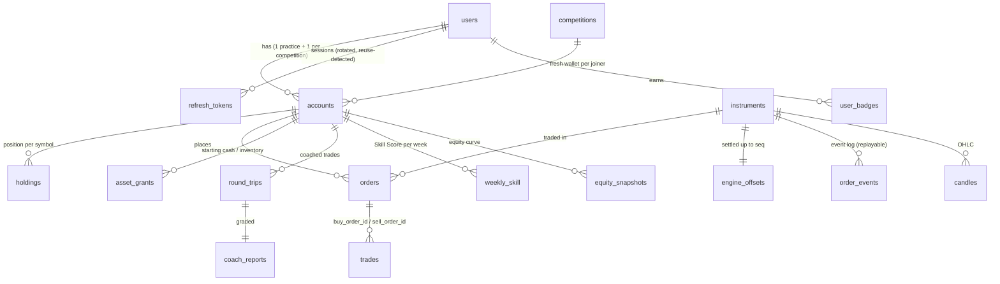

# Database design

PostgreSQL 17. Raw SQL migrations in `db/migrations/` are the source of truth (partitions, CHECKs, triggers, BRIN,
materialized views); Prisma maps only simple CRUD tables. Hot paths use hand-written SQL through `pg`.

## Rules everything follows

- **Money is `BIGINT` paise, quantity is `BIGINT` units.** Never floats. Each instrument has a `qty_scale` (BTC: 10,000
  units = 1 BTC), and tick sizes are multiples of `qty_scale`, so `price × qty / qty_scale` is always a whole number of
  paise — nothing ever rounds.
- **The database enforces the rules that must never break**, with CHECK constraints: `cash_paise >= 0`,
  `cash_held_paise <= cash_paise`, `qty_units >= 0`, `filled_units <= qty_units`, a limit order must have a price, a
  market order can't be GTC, and more. Application code checks too (for clear errors); the database is the last line of
  defence — a buggy write fails its transaction instead of corrupting balances.
- **Every balance change is explained.** Starting cash and bot inventory are recorded in `asset_grants`; everything else
  moves only through `trades`. That makes conservation checkable: cash = grants − buys + sells, for every account.
- **Append-only audit.** Triggers write every cash and holding change into `audit_log`; another trigger blocks UPDATE,
  DELETE and TRUNCATE on it.

## Entity-relationship diagram (core tables)



## Normalisation (3NF) — and where we deliberately don't

The schema is in third normal form: every non-key column depends on the key, the whole key and nothing but the key
(`holdings` is keyed by `(account_id, symbol)`; instrument facts live only in `instruments`; a user's name only in
`users`). Two deliberate, documented exceptions:

- **`orders` is a projection of `order_events`.** The event log is the truth (it rebuilds the order book); `orders` keeps
  the current state of each order for fast queries. Both are written in the same settlement transaction.
- **`trades.notional_paise`** repeats `price × qty / qty_scale`. It's immutable once written and is summed constantly
  (conservation checks, P&L), so storing it avoids recomputing it across millions of rows.

Leaderboards are derived data, kept in materialized views (below), not in tables.

## Transactions, isolation and locking

Each settlement batch is **one transaction at READ COMMITTED with explicit row locks** (`SELECT … FOR UPDATE`):

1. lock `engine_offsets(symbol)` and skip events already applied → **exactly-once**
2. lock every account, then holding, then order the batch touches, **always in the same order** (by id) → two
   transactions can never wait on each other in a cycle → **no deadlocks**
3. apply in memory, write back with bulk `UPDATE … FROM unnest(…)`
4. advance the offset; commit. Any CHECK violation rolls back the whole batch.

Why not SERIALIZABLE? Every row we modify is already locked, so there are no lost updates; SERIALIZABLE would add
serialization failures (and retry storms) on exactly these hot rows for no extra safety. The Trade Coach uses the same
pattern: its cursor, tracked positions and graded trips commit together.

## Partitioning

`trades` and `order_events` are partitioned **by day** (`PARTITION BY RANGE (executed_at / created_at)`). A worker job
creates partitions a week ahead (`ensure_daily_partitions`). Benefits: a query for "the last hour" only touches today's
partition (Postgres prunes the rest — `Subplans Removed: 48` in the plan below), and old data can be dropped a day at a
time instantly. Cost: unique keys must include the partition column (hence `UNIQUE (symbol, seq, executed_at)`), and
planning a query over many partitions takes longer — the time-range plan below spent 329 ms _planning_ and 3 ms
executing, because `now()` isn't known at plan time, so pruning happens at run time. Fewer, wider partitions (weekly)
or a constant time bound would fix that if it mattered.

## Indexes — measured

All plans from `EXPLAIN ANALYZE` on the dev machine (see [PERFORMANCE.md](PERFORMANCE.md) for the hardware). Indexes were
removed inside a transaction (`BEGIN; DROP INDEX …; EXPLAIN ANALYZE …; ROLLBACK;`) so nothing was permanently changed.

### On the live dev database (~60k orders, ~30k trades)

| Query                            | Index                                                             | Without | With               |
| -------------------------------- | ----------------------------------------------------------------- | ------- | ------------------ |
| "my open orders" for one account | **partial** `orders (account_id, symbol) WHERE status IN (open…)` | 2.18 ms | **0.062 ms** (35×) |
| "my trade history", newest 100   | `trades (buyer_account_id, executed_at DESC)` + seller            | 4.42 ms | 3.22 ms            |

The partial index only contains live orders (a handful), so it stays tiny no matter how many filled orders pile up. The
trade-history index barely helps **yet**: the table is small, and the plan visits ~50 day-partitions (planning dominates).

### On a 2,000,000-row synthetic trades table (temporary table, session only)

| Query                           | Without index              | With index                                                                                                                    |
| ------------------------------- | -------------------------- | ----------------------------------------------------------------------------------------------------------------------------- |
| one account's newest 100 trades | 291 ms (parallel seq scan) | **1.25 ms** — composite B-tree `(account_id, executed_at DESC)`: an index scan that is already in the right order, so no sort |
| count trades in a 1-hour window | 366 ms                     | **5.6 ms** — **BRIN** on `executed_at`                                                                                        |

Index sizes for that table: table **100 MB**, B-tree on `executed_at` **43 MB**, BRIN **24 kB**. BRIN stores only the
min/max value per block range; it works because rows arrive in time order (append-only), so each block covers a narrow
time range. That's why the time columns of `trades`, `order_events`, `audit_log` and `equity_snapshots` use BRIN, while
"lookup by account" uses B-trees.

Reproduce: `psql -d tradecore -v acct=<account id> -f scripts/sql/explain-indexes.sql`.

## Materialized views

```sql
mv_portfolio_summary   -- equity per human account: cash + Σ(qty × reference price / qty_scale), coach stats
mv_leaderboard         -- RANK() OVER (PARTITION BY competition_id ORDER BY return DESC), participants count
```

Refreshed every 10 s by the worker with `REFRESH MATERIALIZED VIEW CONCURRENTLY`, which needs a UNIQUE index on each view
and lets readers keep reading during the refresh. A leaderboard read is then an index lookup (0.18 ms) instead of a
per-request aggregation over accounts, holdings and prices. Trade-off: up to 10 s stale.

## Window functions used

- **Candles (OHLC):** `first_value(price) OVER (PARTITION BY symbol, bucket ORDER BY time)` = open,
  `last_value(price) OVER (… ROWS BETWEEN UNBOUNDED PRECEDING AND UNBOUNDED FOLLOWING)` = close; `date_bin()` makes buckets.
- **Moving average:** `avg(close) OVER (ORDER BY bucket ROWS BETWEEN 19 PRECEDING AND CURRENT ROW)` (MA20).
- **Leaderboards:** `RANK()` and `count(*) OVER (PARTITION BY competition_id)`.
- **Drawdown:** `max(equity) OVER (PARTITION BY account, week ORDER BY ts)` = running peak; drawdown = min(equity − peak).
- **Coach:** `percentile_cont(0.5) WITHIN GROUP (…)` for median holding time; `FILTER (WHERE …)` aggregates for average
  win / loss; `unnest(flags)` to count habits.
